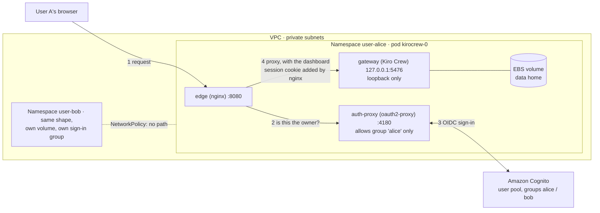

# Option B: one Kiro Crew pod per user on Amazon EKS

A proof of concept for teams that want central hosting **and** separate identity per person.

Kiro Crew is built around one owner per instance. Its data home holds that owner's Kiro sign-in and the OAuth tokens
for services such as Jira, and a second person signing in on the same instance overwrites the first. Option A (the
rest of this repository) runs one shared Gateway. Option B gives every user their own Gateway in their own pod, with
their own volume, and puts a sign-in in front of each pod that lets in only that user.

**Status: deployed and tested on a live cluster** (results below). It is a POC. [What is not production-ready](#what-this-poc-does-not-do)
lists the gaps.

| | Option A (EC2, shared Gateway) | Option B (EKS, one pod per user) |
|---|---|---|
| Users per Gateway | One owner (everyone else shares that identity) | One |
| Sign-in credentials, Jira and MCP tokens | The owner's, shared | Separate per user, kept in that user's own volume |
| Isolation between users | None | Pod, volume, namespace, NetworkPolicy, per-user sign-in group |
| Self-healing | Auto Scaling group, state in S3 | Kubernetes restarts the pod, state on an EBS volume |
| Monthly cost shape | One instance | EKS control plane, a node, NAT, one volume per user |
| Built with | CloudFormation | AWS CDK (TypeScript) |

## How it works



Per request, inside one pod, everything on the pod's loopback:

1. The browser asks nginx (`edge`) for a page.
2. nginx asks `oauth2-proxy` whether this request carries a valid session for **this pod's owner**. If not, the user is sent to Cognito.
3. Cognito signs the user in. `oauth2-proxy` accepts only users in the Cognito group named after the pod's owner.
4. nginx forwards the request to the Gateway and swaps in Crew's own dashboard session cookie. **The browser never sees that cookie.**

The Gateway binds to `127.0.0.1`, so nothing but the two sidecars in the same pod can reach it, even without a NetworkPolicy.

### What the stack creates

- VPC (2 AZs, one NAT gateway) with flow logs to CloudWatch, EKS 1.34 cluster, one managed node group (AL2023, Graviton `m7g.xlarge`).
- Cluster hardening: all five control plane log types to CloudWatch, Kubernetes Secrets envelope-encrypted with a
  customer-managed rotating KMS key, access entries for cluster admin, optional restriction of the public API endpoint.
- Add-ons: VPC CNI with network policy enforcement, EKS Pod Identity agent, EBS CSI driver (via Pod Identity).
- Cognito user pool with two users (`alice`, `bob`), one group each, a 14-character password policy, optional TOTP MFA,
  and an app client for `oauth2-proxy`.
- Per user: namespace (Pod Security `baseline` enforced, `restricted` audited), ResourceQuota, LimitRange,
  ServiceAccount (no API token mounted), StatefulSet (1 replica, 20 GiB encrypted gp3 volume), Service,
  default-deny-style NetworkPolicy, Secret.
- Images: Kiro Crew, nginx and oauth2-proxy are all pinned by multi-arch index digest. The proxy and nginx containers
  run with a read-only root filesystem and all Linux capabilities dropped.

### Best-practice checks

`cdk synth` runs [cdk-nag](https://github.com/cdklabs/cdk-nag) with the `AwsSolutions` rule pack (`bin/app.ts`), and
`cdk synth --strict` passes. Findings that are deliberate for a proof of concept are acknowledged in
`lib/per-user-crew-stack.ts` with a written reason each (optional MFA, public API endpoint, AWS managed policies that
EKS requires, wildcard permissions inside the CDK EKS construct). A new finding fails the synth. The design follows the
[Amazon EKS best practices guide](https://docs.aws.amazon.com/eks/latest/best-practices/introduction.html) on
multi-tenancy (namespace per tenant, network policy, quotas, Pod Security), control plane logging and Secret encryption.

## Deploy

Needs Node 20+, AWS credentials for an account bootstrapped for CDK, `kubectl`, and Python 3 with `boto3`.

```bash
cd option-b-eks-per-user
npm install

# Confirm the image digest first (see ../scripts/verify-image.sh), then edit bin/app.ts if it changed.

# adminRoleArn grants YOUR role cluster-admin through an EKS access entry. For IAM Identity Center use the role ARN
# including its path: arn:aws:iam::<account>:role/aws-reserved/sso.amazonaws.com/AWSReservedSSO_<name>_<id>
npx cdk deploy -c adminRoleArn=<your role arn>        # about 20 minutes the first time

# Optional but recommended: limit who can reach the public Kubernetes API endpoint (still IAM-authenticated either way)
#   npx cdk deploy -c adminRoleArn=<your role arn> -c apiAllowedCidrs=203.0.113.4/32

aws eks update-kubeconfig --region us-east-1 --name kirocrew-eks-poc --alias kirocrew-eks-poc
python3 scripts/set-test-passwords.py                 # test passwords go to ~/.kirocrew-eks-poc/passwords.json (mode 600)
```

New pods are not picked up by a **stuck** StatefulSet: if a pod is crash-looping after a change, delete it
(`kubectl -n user-alice delete pod kirocrew-0`) and the StatefulSet recreates it from the current template. The
volume stays.

### Repeating the sign-in test

Once you have signed in, the browser keeps two sessions: Cognito's own, and the proxy cookie (valid 168 hours). A
second visit then goes straight to the dashboard and never shows the Cognito page. That is correct behaviour, not a
bypass, but it makes the sign-in hard to see again. To reset a pod's sign-in, open its `SignOut-<user>` stack output
in the browser (`cdk-outputs.json` after a deploy, or `aws cloudformation describe-stacks`). It ends the Cognito session
and then the proxy session, and the next visit shows the Cognito page. Closing every private window works too.

### Try it yourself

```bash
kubectl -n user-alice port-forward svc/edge 8081:8080        # terminal 1
kubectl -n user-bob   port-forward svc/edge 8082:8080        # terminal 2
```

Open `http://localhost:8081`, sign in as `alice` (password in `~/.kirocrew-eks-poc/passwords.json`). You get alice's
dashboard. Try the same user at `http://localhost:8082` and you get `403 Forbidden`.

Then sign each pod's Kiro CLI in once. This is the step that needs a browser, so it is **not** automated or tested here:

```bash
kubectl -n user-alice exec -it kirocrew-0 -c gateway -- \
  kiro-cli login --use-device-flow --license pro --identity-provider <IAM Identity Center start URL> --region <region>
```

## Test

```bash
bash scripts/smoke-test.sh                 # 12 network, isolation and sandbox checks, read-only
node scripts/e2e-login.mjs                 # real-browser sign-in for 4 user/pod combinations
bash scripts/persistence-test.sh alice     # deletes alice's pod and checks her data survives (the volume stays)
```

`e2e-login.mjs` needs `playwright-core` and a Chromium binary (`PLAYWRIGHT_CORE`, `CHROMIUM_PATH`). It starts its own
port-forwards and prints only statuses and page titles, never a password, cookie value or token.

### Results from the live run

Run against a stack deployed **from scratch** with the hardened template in this repository (a clean `cdk deploy`,
about 19 minutes, no manual steps other than setting the test passwords). Kubernetes 1.34, AL2023 arm64 nodes,
`ghcr.io/kirodotdev/kirocrew` stable (Crew 0.10.0, index digest `sha256:b6d0b9a3…`).

| Check | Result |
|---|---|
| Both pods Ready (gateway, auth-proxy, edge) | pass |
| Gateway refuses connections on the pod IP (loopback bind) | pass |
| alice cannot reach bob's pod, bob cannot reach alice's | pass |
| Positive control: a pod can reach its **own** IP, so the failures above are the NetworkPolicy | pass |
| Pods cannot reach the node metadata service (169.254.169.254) | pass |
| Pods can still reach the public internet | pass |
| Unauthenticated request to the dashboard or the API is redirected to Cognito (302), not served | pass |
| alice signs in at her pod and gets the real dashboard; bob likewise at his | pass |
| bob signing in at alice's pod, and alice at bob's, gets 403 | pass |
| The dashboard session cookie never reaches the browser (browser holds only the proxy and Cognito cookies) | pass |
| Crew's agent sandbox backend is `namespace` (works with default pod seccomp, non-root, no AppArmor on AL2023) | pass |
| A file written to the data home survives deleting the pod | pass |

## Things learned while building it (worth knowing before you adapt this)

- **The dashboard token must be minted inside the Gateway's own container.** The Gateway only mints a session token
  for a caller it can verify shares its namespaces. A separate sidecar is refused with `HTTP 403: could not verify
  this process as the local owner`, and `shareProcessNamespace` does not fix it. So the token refresher runs as a
  background loop in the Gateway container (see `gatewayStart` in the stack) and writes a file that nginx includes.
- **oauth2-proxy cannot do the cookie injection.** Its header injection reads a file once at startup, and it adds a
  second `Cookie` header rather than replacing the browser's. nginx does it: `proxy_set_header Cookie` replaces.
- **nginx buffers must be raised.** oauth2-proxy keeps the Cognito tokens in its session cookie, split across several
  cookies. With nginx defaults the first sign-in ends in `502 upstream sent too big header`.
- **The Gateway redirects `/` to `http://localhost:5476/`**, so nginx sends `Host: localhost:5476` and rewrites that
  redirect back to the address the browser used.
- **Crew checks Host and Origin.** Set `KIROCREW_CORS_ORIGINS` to the address the browser uses (done per pod).
- **Dashboard session tokens last 20 hours at most.** The refresher mints a new one every 10 hours and nginx
  reloads within 30 seconds of the file changing.
- **A Secrets Manager dynamic reference does not resolve inside a kubectl manifest**; it arrives as literal
  `{{resolve:...}}` text. The cookie secret is generated with a CDK custom resource instead.
- **A crash-looping StatefulSet pod blocks its own rollout.** Delete the pod after fixing the template.

## What this POC does not do

Treat these as the to-do list for a real deployment.

- **Access is `kubectl port-forward` to `localhost`.** A real deployment needs an HTTPS host per user (ALB, ACM, Route 53),
  Cognito callbacks on those hosts, `--cookie-secure=true`, and `KIROCREW_CORS_ORIGINS` set to each host.
- **Secrets pass through the stack.** The Cognito client secret and the generated cookie secret are copied into Kubernetes
  Secrets by the template. Use the Secrets Store CSI Driver or External Secrets with Pod Identity instead.
- **Pod logs contain a dashboard login link.** The Gateway prints a startup sign-in link to its log at boot. Anyone who can
  read the pod's logs can use it until it expires, so restrict log access (and think about where logs are shipped).
- **The token file is mounted in the Gateway container too.** The refresher has to run there. Whether Crew's agent
  sandbox hides that mount from agent-spawned processes was **not** tested.
- **Users, passwords and MFA.** Two Cognito users with MFA off and a generated password file. A real deployment federates
  Cognito to the customer's identity provider (for example IAM Identity Center) and turns MFA on.
- **Per-user Kiro and Jira sign-in were not tested end to end.** Each pod has its own data home, so tokens are separate by
  construction, but the device-flow Kiro sign-in and a Jira OAuth connection were not exercised here.
- **No high availability.** One node, one NAT gateway, one replica per user. Size the node for concurrency: Crew's docs
  give roughly 10 GB RAM as a minimum for an active user, and two idle pods fit on a 16 GiB node, two busy ones may not.
- **Volumes are tied to one Availability Zone, and the node group spans two.** If a replacement node starts in the other
  zone, a pod stays `Pending` with a volume node-affinity conflict. For real use run one node group per zone (or pin
  the group to one zone) and size each for its tenants.
- **Account cleanup tools can shut this down.** A scheduled cleaner that stops or scales idle resources will scale the
  node group to zero, and every pod then sits `Pending` with "no nodes available". Tag the stack the way your
  organization's tooling expects: `cdk deploy -c extraTags=<key>=<value>[,<key>=<value>]`. If it happens, restore the
  node group with `aws eks update-nodegroup-config ... --scaling-config minSize=1,maxSize=2,desiredSize=1`. The
  volumes and their data are not touched.
- **Long-running behaviour is untested.** Nothing here ran for 20 hours, so the token refresh cycle was observed once,
  not across expiry.
- **Sandbox result is for this node type.** Ubuntu or Bottlerocket nodes, nodes with AppArmor, or a cluster that enforces
  `seccompProfile: RuntimeDefault` behave differently. See the "Kubernetes and AppArmor" section of upstream's
  [Docker guide](https://github.com/kirodotdev/KiroCrew/blob/main/docs/guides/docker.md).
- **The Kubernetes API endpoint is public by default** (IAM-authenticated). Use `-c apiAllowedCidrs=...`, or a private
  endpoint with a bastion, for anything beyond a short test.
- **MFA is optional** so the scripted browser test can sign in with a password. Set `mfa: cognito.Mfa.REQUIRED`.
- **Pod Security is `baseline`, not `restricted`.** `restricted` forces a seccomp profile that blocks the `unshare` calls
  Crew's agent sandbox needs. The namespace audits and warns on `restricted` so you can see the gap.
- **Node IMDS is not locked down.** Tenant pods are blocked from the metadata service by NetworkPolicy, but the node
  launch template does not enforce IMDSv2 with a hop limit of 1.
- **The CDK-created roles got a cdk-nag review, not a least-privilege review.**

## Cost

Estimate only, check the AWS Pricing Calculator: EKS control plane $0.10/h, one `m7g.xlarge` about $0.16/h, one NAT
gateway $0.045/h plus data, two 20 GiB gp3 volumes. Roughly **$0.30 to $0.35 per hour, about $8 a day**, while it runs.
Tear it down when you are finished testing.

## Teardown

```bash
bash scripts/teardown.sh
```

It deletes the user namespaces first, so the EBS CSI driver can delete each user's volume, then destroys the stack and lists any
volume still tagged to the cluster. Destroying the cluster first would orphan the volumes and they would keep billing.
